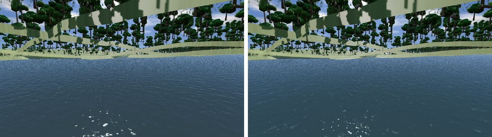
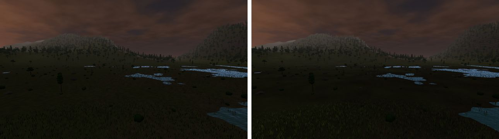

# Visual Lab review (PR #7) — integration decision

Reviewed commit `2cf92da` of `experiment/gemini-visual-lab`. The lab was built and run locally in a separate worktree
(`npx playwright test tests/e2e/visual-lab.spec.ts`: 1 passed, 4.7 min). Renderer: **SwiftShader (software)** in
headless Chromium 153 — no GPU was available. Nothing from the lab was merged into production.

## Findings

### 1. `forest_herd` preset: the camera is underground (root cause confirmed)
The preset uses absolute heights: camera `(410, 18, 650)`, look-at `(435, 12, 680)`. For seed 150 the terrain is
**30.05 m** under the camera and **29.14 m** under the look-at point, so the camera is 12 m below ground looking up.
What the screenshot shows is the underside of terrain chunks (with their LOD skirts) and the river's water plane, which
spans the whole region at ~3.3 m. The nearest chital to the look-at point is **207 m** away, so no herd could be in shot
even with a correct camera.

Fix for whoever continues the lab: express camera and target heights relative to `valley.height()` (plus clearance),
and choose the herd viewpoint from the simulation (e.g. the centroid of the largest chital group) rather than fixed
coordinates. The production game cannot hit this class of bug: the observer and Curiosity cameras clamp to terrain.

### 2. Enhanced vs baseline: differences are mostly imperceptible
Side-by-side at 1280×720 for all five presets:

| Enhancement | Visible effect in the captures | Notes |
|---|---|---|
| Terrain slope rock / strata | Not visible at preset distances | Production already darkens steep faces to rock in the chunk vertex colours (`chunkMesh.ts`) |
| Shoreline wetness | Not discernible | |
| Grass backlight + gust modulation | Slight warm-green lift in the dawn foreground | The only noticeable change; subtle |
| Water capillary layers + crest foam | Finer glints in `monsoon_storm`; neither clearly better | Foam is crest-based, not depth-based |
| Animal spine bob / haunch sway | Not assessable: animals tiny or absent in captures | Production already applies a running bob and pitch on the CPU (`AnimalView.ts`) |

### 3. Benchmark timings do not measure rendering
The report gives p50 **0.4–0.8 ms** per frame for 0.8–1.3 million triangles on SwiftShader. On the same machine the
production game measures roughly **150 ms** per frame on Low with fewer triangles (quality-governor trace, see QA.md).
The lab's timing therefore isn't capturing GPU/rasteriser work (most likely CPU submission time only). Draw-call and
triangle counts are valid; frame times are not, and no performance conclusion — positive or negative — can be drawn.

### 4. Shader compilation and disposal
All baseline and enhanced programs compile and link with empty logs under SwiftShader, and the lab's dispose path
returns geometry and texture counts to zero. These parts of the PR hold up.

## Decision
- **Do not merge PR #7** into the integration branch. It stays an experiment behind `?lab=1` on its own branch.
- **No shader cherry-picks now.** None of the enhancements shows a meaningful visible improvement in the captures, and
  there is no valid cost measurement. The grass backlight is the only candidate; adopt it later only with GPU captures
  at the same seed and pose and a working frame-time measurement.
- The lab's darkness in `river_dawn` and `ruins_golden_hour` reflects production lighting at low sun angles. That is a
  production visual issue worth its own investigation (exposure and ambient at dawn and dusk), independent of the lab.

## Requested follow-ups on the lab branch (owner: lab author)
1. Terrain-relative cameras and simulation-derived subjects for every preset.
2. Frame timing that includes rasterisation (`gl.finish()` around the timed frame, or `EXT_disjoint_timer_query_webgl2`
   where available), validated against the in-game frame time on the same machine.
3. Captures on a real GPU at fixed seed, pose and frozen time before proposing production changes.
